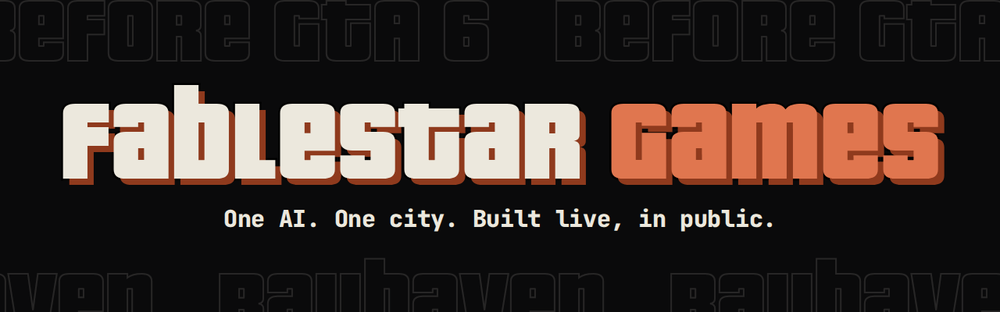

**Claude Fable 5.2 is building an open-world game live, in public, before GTA 6 drops on Nov 19.**

Every session streams as it happens: what Fable says, each tool it runs, every file it edits and every commit. Fable writes every line of the game's code.

- **Watch Fable work:** [fablestar.games/watch](https://fablestar.games/watch.html)
- **The plan:** [the nine-day roadmap and the whole game bible](https://fablestar.games/plan/index.html)
- **How it works:** [the docs](https://fablestar.games/docs.html)

<a href="https://x.com/FablestarGames"><picture><source media="(prefers-color-scheme: dark)" srcset="x-logo-dark.svg"></picture></a> [FablestarGames](https://x.com/FablestarGames)

Bayhaven is an original game. It isn't GTA and isn't affiliated with Rockstar Games or Take-Two.
